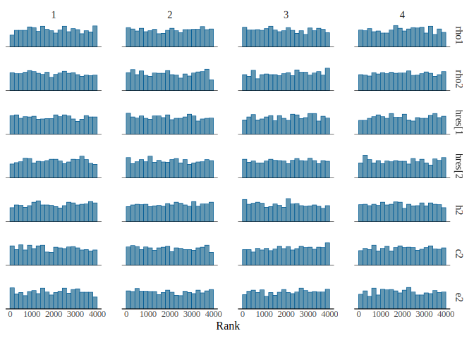
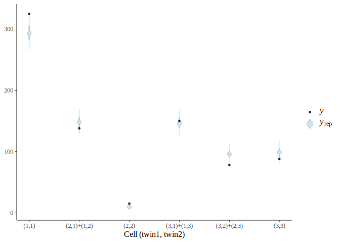
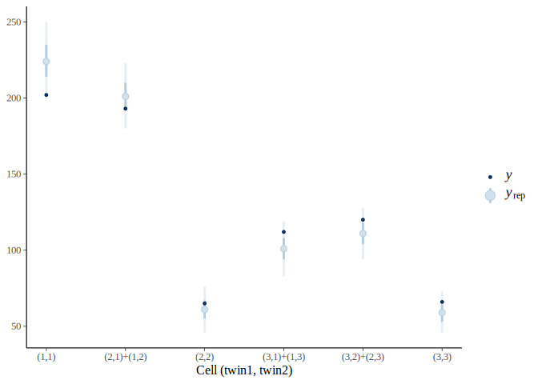
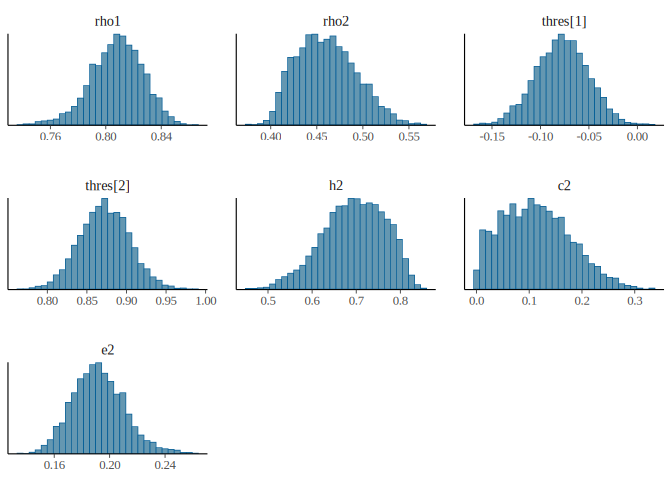

# ACE Model (Full Data)

### Step 0: Install and load required packages (as in `ace-subset.qmd`)

``` r
library(cmdstanr)
```

    This is cmdstanr version 0.9.0

    - CmdStanR documentation and vignettes: mc-stan.org/cmdstanr

    - CmdStan path: /home/marklai/.cmdstan/cmdstan-2.40.0

    - CmdStan version: 2.40.0

``` r
register_knitr_engine()
options(mc.cores = min(parallel::detectCores() - 1, 4)) # Use four CPU cores for MCMC sampling, if available
library(bayesplot)
```

    This is bayesplot version 1.16.0

    - Online documentation and vignettes at mc-stan.org/bayesplot

    - bayesplot theme set to bayesplot::theme_default()

       * Does _not_ affect other ggplot2 plots

       * See ?bayesplot_theme_set for details on theme setting

``` r
library(ggplot2)
```

### Step 1: Data import

``` r
n_mz <- c(325, 60, 7, 78, 150, 40, 8, 38, 88)
n_dz <- c(202, 97, 19, 96, 112, 64, 46, 56, 66)
# Convert to long format data frame
dat_mz <- data.frame(
    twin1 = rep(rep(1:3, 3), n_mz),
    twin2 = rep(rep(1:3, each = 3), n_mz)
)
dat_dz <- data.frame(
    twin1 = rep(rep(1:3, 3), n_dz),
    twin2 = rep(rep(1:3, each = 3), n_dz)
)
dat_mz[] <- lapply(dat_mz, ordered, labels = c("normal", "overweight", "obese"))
dat_dz[] <- lapply(dat_dz, ordered, labels = c("normal", "overweight", "obese"))
dat_full <- rbind(
    data.frame(zygosity = "MZ", dat_mz),
    data.frame(zygosity = "DZ", dat_dz)
)
dat <- dat_full
```

``` r
str(dat)
```

    'data.frame':   1552 obs. of  3 variables:
     $ zygosity: chr  "MZ" "MZ" "MZ" "MZ" ...
     $ twin1   : Ord.factor w/ 3 levels "normal"<"overweight"<..: 1 1 1 1 1 1 1 1 1 1 ...
     $ twin2   : Ord.factor w/ 3 levels "normal"<"overweight"<..: 1 1 1 1 1 1 1 1 1 1 ...

``` r
summary(dat)
```

          zygosity           twin1            twin2    
     Length   :1552   normal    :755   normal    :710  
     N.unique :   2   overweight:513   overweight:540  
     N.blank  :   0   obese     :284   obese     :302  
     Min.nchar:   2                                    
     Max.nchar:   2                                    

``` r
tab_mz <- with(dat[dat$zygosity == "MZ", ], table(twin1, twin2))
tab_dz <- with(dat[dat$zygosity == "DZ", ], table(twin1, twin2))
```

### Step 2: Compile the Stan model

``` stan
//
// This Stan program estimates the polychoric correlation between two
// ordinal variables, and decompose based on an ACE model. This model
// assumes symmetry in the contingency table.
//
functions {
  #include "ace_fun.stan"
}
data {
  int<lower=0> k;  // number of categories
  array[k * (k + 1) %/% 2] int<lower=0> ltri_ns1;  // mz
  array[k * (k + 1) %/% 2] int<lower=0> ltri_ns2;  // dz
}
transformed data {
  int kprime = k * (k + 1) %/% 2;
  int N1 = sum(ltri_ns1);  // total N for mz
  real N1real = N1;  // convert from integer to real number
  int N2 = sum(ltri_ns2);  // total N for dz
  real N2real = N2;  // convert from integer to real number
}
parameters {
  real<lower=0, upper=1> scaled_rho1;
  real<lower=0, upper=1> scaled_rho2;
  ordered[k - 1] thres;
}
transformed parameters {
  real rho1 = scaled_rho1 * 2 - 1;
  real rho2 = scaled_rho2 * 2 - 1;
  // Implied probabilities for each cell
  vector<lower=0>[kprime] pi1 =
    vec_symm(polycor_to_prob(thres, rho1));
  vector<lower=0>[kprime] pi2 =
    vec_symm(polycor_to_prob(thres, rho2));
}
// The model to be estimated.
model {
  // prior
  scaled_rho1 ~ beta(1.5, 1.5);
  scaled_rho2 ~ beta(1.5, 1.5);
  thres ~ student_t(4, 0, 2.5);
  // likelihood
  ltri_ns1 ~ multinomial(pi1);
  ltri_ns2 ~ multinomial(pi2);
}
generated quantities {
  // Compute a^2, c^2, and e^2 from rho
  real h2 = 2 * (rho1 - rho2);
  real c2 = 2 * rho2 - rho1;
  real e2 = 1 - rho1;
  // Intialize X^2 for each group
  real X2_1_samp = 0.0;
  real X2_2_samp = 0.0;
  // Initialize X^2 > X^2_rep indicator (for posterior predictive p)
  int<lower=0, upper=1> X2_1_gt;
  int<lower=0, upper=1> X2_2_gt;
  // Simulate new cell counts
  array[kprime] int ltri_ns1_tilde = multinomial_rng(pi1, N1);
  array[kprime] int ltri_ns2_tilde = multinomial_rng(pi2, N2);
  {
    vector[kprime] N1pi1 = N1real .* pi1;
    vector[kprime] N2pi2 = N2real .* pi2;
    // initialize X^2_rep for each group
    real X2_1_rep = 0.0;
    real X2_2_rep = 0.0;
    for (idx in 1:kprime) {
      real ns1_exp = N1pi1[idx];
      real ns2_exp = N2pi2[idx];
      // loop over each cell, and add the discrepancy to X2
      X2_1_samp += (ltri_ns1[idx] - ns1_exp)^2 / ns1_exp;
      X2_2_samp += (ltri_ns2[idx] - ns2_exp)^2 / ns2_exp;
      X2_1_rep += (ltri_ns1_tilde[idx] - ns1_exp)^2 / ns1_exp;
      X2_2_rep += (ltri_ns2_tilde[idx] - ns2_exp)^2 / ns2_exp;
    }
    X2_1_gt = X2_1_rep > X2_1_samp;
    X2_2_gt = X2_2_rep > X2_2_samp;
  }
}
```

### Step 3: Prepare data and sampling

``` r
# Reduced frequency vector
to_ltri <- function(tab_x) {
    symm_x <- tab_x + t(tab_x) - diag(diag(tab_x))
    ltri_x <- symm_x[lower.tri(symm_x, diag = TRUE)]
}
(ltri_nmz <- to_ltri(tab_mz))
```

    [1] 325 138  15 150  78  88

``` r
(ltri_ndz <- to_ltri(tab_dz))
```

    [1] 202 193  65 112 120  66

``` r
ace_fit <- ace$sample(
    list(k = 3, ltri_ns1 = ltri_nmz, ltri_ns2 = ltri_ndz),
    chains = 4,
    iter_warmup = 1000,
    iter_sampling = 1000,
    seed = 732 # for reproducibility
)
```

### Step 4: Check convergence

``` r
params <- c("rho1", "rho2", "thres", "h2", "c2", "e2")
ace_fit$print(params)
```

     variable  mean median   sd  mad    q5   q95 rhat ess_bulk ess_tail
     rho1      0.81   0.81 0.02 0.02  0.78  0.84 1.00     3678     3116
     rho2      0.45   0.45 0.04 0.04  0.39  0.51 1.00     3404     3198
     thres[1] -0.08  -0.08 0.03 0.03 -0.12 -0.03 1.00     3496     3183
     thres[2]  0.87   0.87 0.03 0.03  0.82  0.92 1.00     6037     3465
     h2        0.71   0.71 0.08 0.09  0.58  0.85 1.00     3615     2968
     c2        0.10   0.10 0.08 0.08 -0.03  0.22 1.00     3490     3124
     e2        0.19   0.19 0.02 0.02  0.16  0.22 1.00     3678     3116

``` r
ace_fit$diagnostic_summary()
```

    $num_divergent
    [1] 0 0 0 0

    $num_max_treedepth
    [1] 0 0 0 0

    $ebfmi
    [1] 0.9564986 1.0288214 1.2143368 1.0661912

``` r
ace_fit$draws(params) |>
    mcmc_rank_hist()
```

<div id="fig-rank-hist">



Figure 1: Figure 1: Rank histograms for the main model parameters

</div>

### Step 5: Model checking

#### Repeat Steps 3 and 4 with reparameterized model

With unreasonable h2 and c2, we reparameterize the model to enforce
theory-informed priors/constraints.

``` stan
//
// This Stan program estimates the polychoric correlation between two
// ordinal variables, and decompose based on an ACE model. The model is
// parameterized using a simplex for the ACE components to enforce
// nonzero variances, and assumes symmetry in the contingency table.
//
functions {
  #include "ace_fun.stan"
}
data {
  int<lower=0> k;  // number of categories
  array[k * (k + 1) %/% 2] int<lower=0> ltri_ns1;  // mz
  array[k * (k + 1) %/% 2] int<lower=0> ltri_ns2;  // dz
}
transformed data {
  int kprime = k * (k + 1) %/% 2;
  int N1 = sum(ltri_ns1);  // total N for mz
  real N1real = N1;  // convert from integer to real number
  int N2 = sum(ltri_ns2);  // total N for dz
  real N2real = N2;  // convert from integer to real number
}
parameters {
  simplex[3] ace;
  ordered[k - 1] thres;
}
transformed parameters {
  real rho1 = ace[1] + ace[2];
  real rho2 = ace[1] / 2 + ace[2];
  // Implied probabilities for each cell
  vector<lower=0>[kprime] pi1 =
    vec_symm(polycor_to_prob(thres, rho1));
  vector<lower=0>[kprime] pi2 =
    vec_symm(polycor_to_prob(thres, rho2));
}
// The model to be estimated.
model {
  // prior
  ace ~ dirichlet([1, 1, 1]');
  thres ~ student_t(4, 0, 2.5);
  // likelihood
  ltri_ns1 ~ multinomial(pi1);
  ltri_ns2 ~ multinomial(pi2);
}
generated quantities {
  // Extract the simplex parameter into a^2, c^2, and e^2
  real h2 = ace[1];
  real c2 = ace[2];
  real e2 = ace[3];
  // Intialize X^2 for each group
  real X2_1_samp = 0.0;
  real X2_2_samp = 0.0;
  // Initialize X^2 > X^2_rep indicator (for posterior predictive p)
  int<lower=0, upper=1> X2_1_gt;
  int<lower=0, upper=1> X2_2_gt;
  // Simulate new cell counts
  array[kprime] int ltri_ns1_tilde = multinomial_rng(pi1, N1);
  array[kprime] int ltri_ns2_tilde = multinomial_rng(pi2, N2);
  {
    vector[kprime] N1pi1 = N1real .* pi1;
    vector[kprime] N2pi2 = N2real .* pi2;
    // initialize X^2_rep for each group
    real X2_1_rep = 0.0;
    real X2_2_rep = 0.0;
    for (idx in 1:kprime) {
      real ns1_exp = N1pi1[idx];
      real ns2_exp = N2pi2[idx];
      // loop over each cell, and add the discrepancy to X2
      X2_1_samp += (ltri_ns1[idx] - ns1_exp)^2 / ns1_exp;
      X2_2_samp += (ltri_ns2[idx] - ns2_exp)^2 / ns2_exp;
      X2_1_rep += (ltri_ns1_tilde[idx] - ns1_exp)^2 / ns1_exp;
      X2_2_rep += (ltri_ns2_tilde[idx] - ns2_exp)^2 / ns2_exp;
    }
    X2_1_gt = X2_1_rep > X2_1_samp;
    X2_2_gt = X2_2_rep > X2_2_samp;
  }
}
```

One can then repeat steps 3 and 4 to obtain the posterior samples and
convergence diagnostics, which we do not repeat the details here. The
posterior summaries of the main parameters are in
<a href="#tbl-post-summ" class="quarto-xref">Table 1</a>.

``` r
ace_s_fit <- ace_simplex$sample(
    list(k = 3, ltri_ns1 = ltri_nmz, ltri_ns2 = ltri_ndz),
    chains = 4,
    iter_warmup = 1000,
    iter_sampling = 1000,
    seed = 732 # for reproducibility
)
```

``` r
ace_s_fit$summary(params) |>
    knitr::kable(digits = 2)
```

<div id="tbl-post-summ">

Table 1

Table 1: Posterior summary of the main model parameters

<div class="cell-output-display">

| variable   |  mean | median |   sd |  mad |    q5 |   q95 | rhat | ess_bulk | ess_tail |
|:-----------|------:|-------:|-----:|-----:|------:|------:|-----:|---------:|---------:|
| rho1       |  0.81 |   0.81 | 0.02 | 0.02 |  0.78 |  0.84 |    1 |  4419.18 |  3185.97 |
| rho2       |  0.46 |   0.46 | 0.03 | 0.03 |  0.41 |  0.52 |    1 |  1168.77 |  1371.19 |
| thres\[1\] | -0.08 |  -0.08 | 0.03 | 0.03 | -0.12 | -0.03 |    1 |  2166.43 |  2188.17 |
| thres\[2\] |  0.87 |   0.87 | 0.03 | 0.03 |  0.82 |  0.92 |    1 |  3012.89 |  1934.80 |
| h2         |  0.69 |   0.70 | 0.07 | 0.08 |  0.57 |  0.80 |    1 |  1205.91 |  1213.26 |
| c2         |  0.11 |   0.11 | 0.06 | 0.07 |  0.02 |  0.23 |    1 |  1043.27 |   777.09 |
| e2         |  0.19 |   0.19 | 0.02 | 0.02 |  0.16 |  0.22 |    1 |  4419.18 |  3185.97 |

</div>

</div>

#### Global fit

#### Local fit

``` r
x_scale <- scale_x_continuous(
    breaks = seq_along(ltri_nmz),
    labels = c(
        "(1,1)",
        "(2,1)+(1,2)",
        "(3,1)+(1,3)",
        "(2,2)",
        "(3,2)+(2,3)",
        "(3,3)"
    )
)
```

``` r
ace_s_fit$draws("ltri_ns1_tilde", format = "matrix") |>
    ppc_intervals(y = ltri_nmz) +
    xlab("Cell (twin1, twin2)") +
    x_scale
```

<div id="fig-ppc-intervals-mz">



Figure 2: Figure 2: Posterior predictive check for each cell count in
the contingency tables for MZ twins

</div>

``` r
ace_s_fit$draws("ltri_ns2_tilde", format = "matrix") |>
    ppc_intervals(y = ltri_ndz) +
    xlab("Cell (twin1, twin2)") +
    x_scale
```

<div id="fig-ppc-intervals-dz">



Figure 3: Figure 3: Posterior predictive check for each cell count in
the contingency tables for DZ twins

</div>

### Step 6: Summarizing the posterior

``` r
ace_s_fit$draws(params) |>
    mcmc_hist()
```

    `stat_bin()` using `bins = 30`. Pick better value `binwidth`.

<div id="fig-post-dens">



Figure 4: Figure 4: Posterior distributions of the main model parameters

</div>
