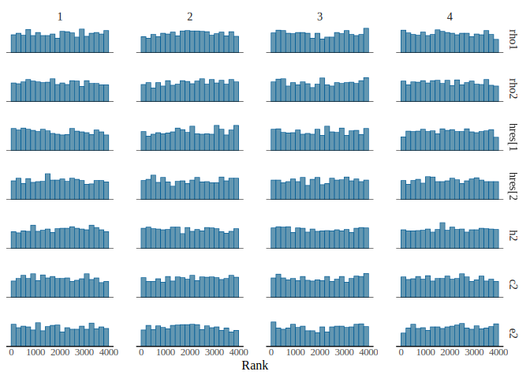
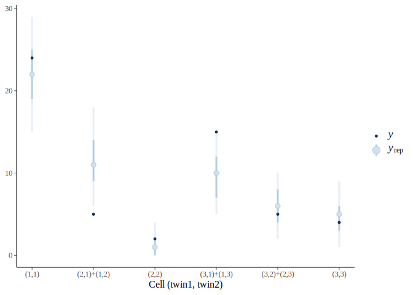
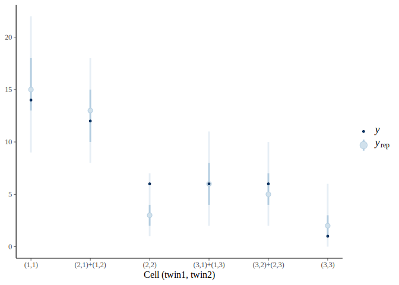
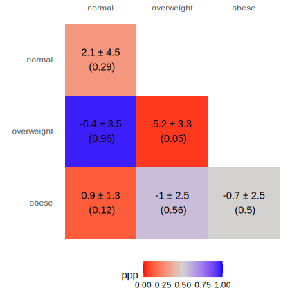
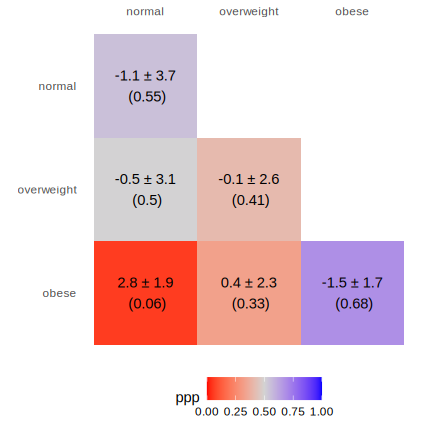
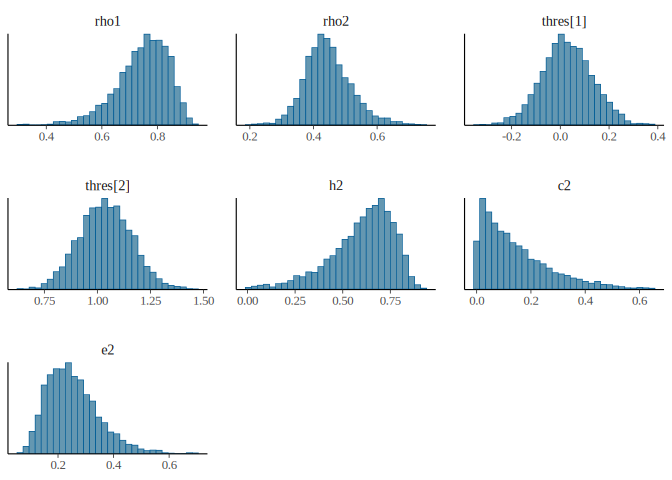

# ACE Model (Subset Data)


### Step 0: Install and load required packages

``` r
# we recommend running this is a fresh R session or restarting your current session
install.packages(
    "cmdstanr",
    repos = c('https://stan-dev.r-universe.dev', getOption("repos"))
)
library(cmdstanr)
# Check toolchains
check_cmdstan_toolchain()
# If toolcahin is not setup properly, follow the printed instructions, or visit https://mc-stan.org/docs/cmdstan-guide/installation.html#cpp-toolchain
# Install cmdstan
cmdstanr::install_cmdstan()
# We also install the bayesplot package visualizing MCMC results
install.packages("bayesplot")
```

``` r
library(cmdstanr)
```

    This is cmdstanr version 0.9.0

    - CmdStanR documentation and vignettes: mc-stan.org/cmdstanr

    - CmdStan path: /home/marklai/.cmdstan/cmdstan-2.40.0

    - CmdStan version: 2.40.0

``` r
register_knitr_engine()
options(mc.cores = min(parallel::detectCores() - 1, 4)) # Use four CPU cores for MCMC sampling, if available
library(bayesplot)
```

    This is bayesplot version 1.16.0

    - Online documentation and vignettes at mc-stan.org/bayesplot

    - bayesplot theme set to bayesplot::theme_default()

       * Does _not_ affect other ggplot2 plots

       * See ?bayesplot_theme_set for details on theme setting

``` r
library(HDInterval)
library(ggplot2)
```

``` r
# Define function for HDI
hdi2 <- function(x, cred_mass = 0.90) {
    hdi_interval <- HDInterval::hdi(x, credMass = cred_mass)
    setNames(hdi_interval, c("hdi_lo", "hdi_hi"))
}
```

### Step 1: Data import

``` r
set.seed(1234)
n_mz <- c(325, 60, 7, 78, 150, 40, 8, 38, 88)
n_dz <- c(202, 97, 19, 96, 112, 64, 46, 56, 66)
# Convert to long format data frame
dat_mz <- data.frame(
    twin1 = rep(rep(1:3, 3), n_mz),
    twin2 = rep(rep(1:3, each = 3), n_mz)
)
dat_dz <- data.frame(
    twin1 = rep(rep(1:3, 3), n_dz),
    twin2 = rep(rep(1:3, each = 3), n_dz)
)
dat_mz[] <- lapply(dat_mz, ordered, labels = c("normal", "overweight", "obese"))
dat_dz[] <- lapply(dat_dz, ordered, labels = c("normal", "overweight", "obese"))
dat_full <- rbind(
    data.frame(zygosity = "MZ", dat_mz),
    data.frame(zygosity = "DZ", dat_dz)
)
sub_n <- 100
dat <- dat_full[sample.int(nrow(dat_full), 100), ]
# dat <- dat_full
```

``` r
str(dat)
```

    'data.frame':   100 obs. of  3 variables:
     $ zygosity: chr  "DZ" "DZ" "DZ" "DZ" ...
     $ twin1   : Ord.factor w/ 3 levels "normal"<"overweight"<..: 2 2 1 2 3 1 3 1 1 1 ...
     $ twin2   : Ord.factor w/ 3 levels "normal"<"overweight"<..: 2 1 2 1 2 1 2 1 2 1 ...

``` r
summary(dat)
```

          zygosity          twin1           twin2   
     Length   :100   normal    :53   normal    :48  
     N.unique :  2   overweight:29   overweight:41  
     N.blank  :  0   obese     :18   obese     :11  
     Min.nchar:  2                                  
     Max.nchar:  2                                  

``` r
tab_mz <- with(dat[dat$zygosity == "MZ", ], table(twin1, twin2))
tab_dz <- with(dat[dat$zygosity == "DZ", ], table(twin1, twin2))
```

### Step 2: Compile the Stan model

``` stan
//
// This Stan program estimates the polychoric correlation between two
// ordinal variables, and decompose based on an ACE model. This model
// assumes symmetry in the contingency table.
//
functions {
  #include "ace_fun.stan"
}
data {
  int<lower=0> k;  // number of categories
  array[k * (k + 1) %/% 2] int<lower=0> ltri_ns1;  // mz
  array[k * (k + 1) %/% 2] int<lower=0> ltri_ns2;  // dz
}
transformed data {
  int kprime = k * (k + 1) %/% 2;
  int N1 = sum(ltri_ns1);  // total N for mz
  real N1real = N1;  // convert from integer to real number
  int N2 = sum(ltri_ns2);  // total N for dz
  real N2real = N2;  // convert from integer to real number
}
parameters {
  real<lower=0, upper=1> scaled_rho1;
  real<lower=0, upper=1> scaled_rho2;
  ordered[k - 1] thres;
}
transformed parameters {
  real rho1 = scaled_rho1 * 2 - 1;
  real rho2 = scaled_rho2 * 2 - 1;
  // Implied probabilities for each cell
  vector<lower=0>[kprime] pi1 =
    vec_symm(polycor_to_prob(thres, rho1));
  vector<lower=0>[kprime] pi2 =
    vec_symm(polycor_to_prob(thres, rho2));
}
// The model to be estimated.
model {
  // prior
  scaled_rho1 ~ beta(1.5, 1.5);
  scaled_rho2 ~ beta(1.5, 1.5);
  thres ~ student_t(4, 0, 2.5);
  // likelihood
  ltri_ns1 ~ multinomial(pi1);
  ltri_ns2 ~ multinomial(pi2);
}
generated quantities {
  // Compute a^2, c^2, and e^2 from rho
  real h2 = 2 * (rho1 - rho2);
  real c2 = 2 * rho2 - rho1;
  real e2 = 1 - rho1;
  // Intialize X^2 for each group
  real X2_1_samp = 0.0;
  real X2_2_samp = 0.0;
  // Initialize X^2 > X^2_rep indicator (for posterior predictive p)
  int<lower=0, upper=1> X2_1_gt;
  int<lower=0, upper=1> X2_2_gt;
  // Simulate new cell counts
  array[kprime] int ltri_ns1_tilde = multinomial_rng(pi1, N1);
  array[kprime] int ltri_ns2_tilde = multinomial_rng(pi2, N2);
  {
    vector[kprime] N1pi1 = N1real .* pi1;
    vector[kprime] N2pi2 = N2real .* pi2;
    // initialize X^2_rep for each group
    real X2_1_rep = 0.0;
    real X2_2_rep = 0.0;
    for (idx in 1:kprime) {
      real ns1_exp = N1pi1[idx];
      real ns2_exp = N2pi2[idx];
      // loop over each cell, and add the discrepancy to X2
      X2_1_samp += (ltri_ns1[idx] - ns1_exp)^2 / ns1_exp;
      X2_2_samp += (ltri_ns2[idx] - ns2_exp)^2 / ns2_exp;
      X2_1_rep += (ltri_ns1_tilde[idx] - ns1_exp)^2 / ns1_exp;
      X2_2_rep += (ltri_ns2_tilde[idx] - ns2_exp)^2 / ns2_exp;
    }
    X2_1_gt = X2_1_rep > X2_1_samp;
    X2_2_gt = X2_2_rep > X2_2_samp;
  }
}
```

### Step 3: Prepare data and sampling

``` r
# Reduced frequency vector
to_ltri <- function(tab_x) {
    symm_x <- tab_x + t(tab_x) - diag(diag(tab_x))
    ltri_x <- symm_x[lower.tri(symm_x, diag = TRUE)]
}
(ltri_nmz <- to_ltri(tab_mz))
```

    [1] 24  5  2 15  5  4

``` r
(ltri_ndz <- to_ltri(tab_dz))
```

    [1] 14 12  6  6  6  1

``` r
ace_fit <- ace$sample(
    list(k = 3, ltri_ns1 = ltri_nmz, ltri_ns2 = ltri_ndz),
    chains = 4,
    iter_warmup = 1000,
    iter_sampling = 1000,
    seed = 732 # for reproducibility
)
```

### Step 4: Check convergence

``` r
params <- c("rho1", "rho2", "thres", "h2", "c2", "e2")
ace_fit$print(params)
```

     variable  mean median   sd  mad    q5  q95 rhat ess_bulk ess_tail
     rho1      0.77   0.78 0.08 0.08  0.62 0.88 1.00     3848     2614
     rho2      0.17   0.18 0.17 0.17 -0.12 0.44 1.00     3473     2789
     thres[1]  0.03   0.03 0.10 0.10 -0.14 0.19 1.00     3414     2968
     thres[2]  1.05   1.05 0.12 0.12  0.85 1.24 1.00     4957     3011
     h2        1.19   1.19 0.37 0.37  0.60 1.82 1.00     3518     2766
     c2       -0.43  -0.42 0.34 0.34 -1.02 0.13 1.00     3488     2828
     e2        0.23   0.22 0.08 0.08  0.12 0.38 1.00     3848     2614

``` r
ace_fit$diagnostic_summary()
```

    $num_divergent
    [1] 0 0 0 0

    $num_max_treedepth
    [1] 0 0 0 0

    $ebfmi
    [1] 1.119438 0.978090 1.064659 1.107778

``` r
ace_fit$draws(params) |>
    mcmc_rank_hist()
```

<div id="fig-rank-hist">



Figure 1: Rank histograms for the main model parameters

</div>

### Step 5: Model checking

#### Repeat Steps 3 and 4 with reparameterized model

With unreasonable h2 and c2, we reparameterize the model to enforce
theory-informed priors/constraints.

``` stan
//
// This Stan program estimates the polychoric correlation between two
// ordinal variables, and decompose based on an ACE model. The model is
// parameterized using a simplex for the ACE components to enforce
// nonzero variances, and assumes symmetry in the contingency table.
//
functions {
  #include "ace_fun.stan"
}
data {
  int<lower=0> k;  // number of categories
  array[k * (k + 1) %/% 2] int<lower=0> ltri_ns1;  // mz
  array[k * (k + 1) %/% 2] int<lower=0> ltri_ns2;  // dz
}
transformed data {
  int kprime = k * (k + 1) %/% 2;
  int N1 = sum(ltri_ns1);  // total N for mz
  real N1real = N1;  // convert from integer to real number
  int N2 = sum(ltri_ns2);  // total N for dz
  real N2real = N2;  // convert from integer to real number
}
parameters {
  simplex[3] ace;
  ordered[k - 1] thres;
}
transformed parameters {
  real rho1 = ace[1] + ace[2];
  real rho2 = ace[1] / 2 + ace[2];
  // Implied probabilities for each cell
  vector<lower=0>[kprime] pi1 =
    vec_symm(polycor_to_prob(thres, rho1));
  vector<lower=0>[kprime] pi2 =
    vec_symm(polycor_to_prob(thres, rho2));
}
// The model to be estimated.
model {
  // prior
  ace ~ dirichlet([1, 1, 1]');
  thres ~ student_t(4, 0, 2.5);
  // likelihood
  ltri_ns1 ~ multinomial(pi1);
  ltri_ns2 ~ multinomial(pi2);
}
generated quantities {
  // Extract the simplex parameter into a^2, c^2, and e^2
  real h2 = ace[1];
  real c2 = ace[2];
  real e2 = ace[3];
  // Intialize X^2 for each group
  real X2_1_samp = 0.0;
  real X2_2_samp = 0.0;
  // Initialize X^2 > X^2_rep indicator (for posterior predictive p)
  int<lower=0, upper=1> X2_1_gt;
  int<lower=0, upper=1> X2_2_gt;
  // Simulate new cell counts
  array[kprime] int ltri_ns1_tilde = multinomial_rng(pi1, N1);
  array[kprime] int ltri_ns2_tilde = multinomial_rng(pi2, N2);
  {
    vector[kprime] N1pi1 = N1real .* pi1;
    vector[kprime] N2pi2 = N2real .* pi2;
    // initialize X^2_rep for each group
    real X2_1_rep = 0.0;
    real X2_2_rep = 0.0;
    for (idx in 1:kprime) {
      real ns1_exp = N1pi1[idx];
      real ns2_exp = N2pi2[idx];
      // loop over each cell, and add the discrepancy to X2
      X2_1_samp += (ltri_ns1[idx] - ns1_exp)^2 / ns1_exp;
      X2_2_samp += (ltri_ns2[idx] - ns2_exp)^2 / ns2_exp;
      X2_1_rep += (ltri_ns1_tilde[idx] - ns1_exp)^2 / ns1_exp;
      X2_2_rep += (ltri_ns2_tilde[idx] - ns2_exp)^2 / ns2_exp;
    }
    X2_1_gt = X2_1_rep > X2_1_samp;
    X2_2_gt = X2_2_rep > X2_2_samp;
  }
}
```

One can then repeat steps 3 and 4 to obtain the posterior samples and
convergence diagnostics, which we do not repeat the details here. The
posterior summaries of the main parameters are in
<a href="#tbl-post-summ" class="quarto-xref">Table 1</a>.

``` r
ace_s_fit <- ace_simplex$sample(
    list(k = 3, ltri_ns1 = ltri_nmz, ltri_ns2 = ltri_ndz),
    chains = 4,
    iter_warmup = 1000,
    iter_sampling = 1000,
    seed = 732 # for reproducibility
)
```

``` r
ace_s_fit$summary(params, mean, median, sd, mad, posterior::quantile2, hdi2) |>
    transform(
        variable = paste0(
            variable,
            " (",
            c(
                "$\\rho^\\text{MZ}$",
                "$\\rho^\\text{DZ}$",
                "$\\tau_1$",
                "$\\tau_2$",
                "$h^2$",
                "$c^2$",
                "$e^2$"
            ),
            ")"
        )
    ) |>
    knitr::kable(digits = 2)
```

<div id="tbl-post-summ">

Table 1: Posterior summary of the main model parameters, based on the
simplex parameterization

<div class="cell-output-display">

| variable                | mean | median |   sd |  mad |    q5 |  q95 | hdi_lo | hdi_hi |
|:------------------------|-----:|-------:|-----:|-----:|------:|-----:|-------:|-------:|
| rho1 ($\rho^\text{MZ}$) | 0.75 |   0.76 | 0.09 | 0.09 |  0.58 | 0.87 |   0.61 |   0.89 |
| rho2 ($\rho^\text{DZ}$) | 0.45 |   0.44 | 0.07 | 0.07 |  0.34 | 0.57 |   0.33 |   0.56 |
| thres\[1\] ($\tau_1$)   | 0.03 |   0.02 | 0.10 | 0.10 | -0.14 | 0.20 |  -0.15 |   0.20 |
| thres\[2\] ($\tau_2$)   | 1.04 |   1.04 | 0.12 | 0.12 |  0.84 | 1.24 |   0.83 |   1.23 |
| h2 ($h^2$)              | 0.60 |   0.63 | 0.17 | 0.15 |  0.27 | 0.81 |   0.34 |   0.85 |
| c2 ($c^2$)              | 0.15 |   0.11 | 0.13 | 0.11 |  0.01 | 0.40 |   0.00 |   0.33 |
| e2 ($e^2$)              | 0.25 |   0.24 | 0.09 | 0.09 |  0.13 | 0.42 |   0.11 |   0.39 |

</div>

</div>

#### Global fit

#### Local fit

``` r
x_scale <- scale_x_continuous(
    breaks = seq_along(ltri_nmz),
    labels = c(
        "(1,1)",
        "(2,1)+(1,2)",
        "(3,1)+(1,3)",
        "(2,2)",
        "(3,2)+(2,3)",
        "(3,3)"
    )
)
```

``` r
ace_s_fit$draws("ltri_ns1_tilde", format = "matrix") |>
    ppc_intervals(y = ltri_nmz) +
    xlab("Cell (twin1, twin2)") +
    x_scale
```

<div id="fig-ppc-intervals-mz">



Figure 2: Posterior predictive check for each cell count in the
contingency tables for MZ twins

</div>

``` r
ace_s_fit$draws("ltri_ns2_tilde", format = "matrix") |>
    ppc_intervals(y = ltri_ndz) +
    xlab("Cell (twin1, twin2)") +
    x_scale
```

<div id="fig-ppc-intervals-dz">



Figure 3: Posterior predictive check for each cell count in the
contingency tables for DZ twins

</div>

<div id="fig-ppp-heatmap">

``` r
# Obtain residuals
ntilde1 <- ace_s_fit$draws("ltri_ns1_tilde", format = "draws_df")
ntilde2 <- ace_s_fit$draws("ltri_ns2_tilde", format = "draws_df")
# Residual: Observed counts - Predicted counts
res1 <- sweep(ntilde1[1:6], MARGIN = 2, ltri_nmz, FUN = \(x, y) y - x)
res2 <- sweep(ntilde2[1:6], MARGIN = 2, ltri_ndz, FUN = \(x, y) y - x)
# Posterior predictive p value
ppp1 <- sapply(res1, function(x) mean(x < 0))
ppp2 <- sapply(res2, function(x) mean(x < 0))

# Prepare data for plotting MZ
new_tab_mz <- as.table(tab_mz) # copy to preserve original
new_tab_mz[lower.tri(new_tab_mz, diag = TRUE)] <- ltri_nmz
new_tab_mz[upper.tri(new_tab_mz)] <- NA
tab_mz_df <- as.data.frame(new_tab_mz)
# Add ppp and residual values
tab_mz_df$ppp[!is.na(tab_mz_df$Freq)] <- ppp1
tab_mz_df$res[!is.na(tab_mz_df$Freq)] <- paste0(
    round(colMeans(res1), 1),
    " ± ",
    round(apply(res1, 2, sd), 1),
    "\n (",
    round(ppp1, 2),
    ")"
)

# Reverse order of twin1 for plot purposes
tab_mz_df$twin1 <- factor(
    tab_mz_df$twin1,
    levels = rev(levels(tab_mz_df$twin1))
)
p1 <- tab_mz_df |>
    ggplot(aes(x = twin2, y = twin1, fill = ppp)) +
    # geom_tile to draw the graph
    geom_tile() +
    # Add residuals directly with geom_text()
    geom_text(aes(label = res), na.rm = TRUE) +
    # Put x axis on top
    scale_x_discrete(position = "top") +
    # Color the graph: Red for small ppp, blue for large ppp
    # Here ppp close to zero are red, and those close to one are blue
    # gradient2 instead of gradient gives us a "mid" color which we can make white
    scale_fill_gradient2(
        low = "red",
        high = "blue",
        mid = "lightgrey",
        midpoint = 0.5,
        na.value = rgb(0, 0, 0, 0),
        limit = c(0, 1),
        space = "Lab"
    ) +
    # Drop axis names
    labs(x = NULL, y = NULL) +
    # Remove background
    theme_minimal() +
    # Make cells to be square!
    coord_fixed() +
    # Remove grid lines and place legend at bottom
    theme(legend.position = "bottom", panel.grid = element_blank())

# Repeat for DZ
new_tab_dz <- as.table(tab_dz) # copy to preserve original
new_tab_dz[lower.tri(new_tab_dz, diag = TRUE)] <- ltri_ndz
new_tab_dz[upper.tri(new_tab_dz)] <- NA
tab_dz_df <- as.data.frame(new_tab_dz)
# Add ppp and residual values
tab_dz_df$ppp[!is.na(tab_dz_df$Freq)] <- ppp2
tab_dz_df$res[!is.na(tab_dz_df$Freq)] <- paste0(
    round(colMeans(res2), 1),
    " ± ",
    round(apply(res2, 2, sd), 1),
    "\n (",
    round(ppp2, 2),
    ")"
)
# Reverse order of twin1 for plot purposes
tab_dz_df$twin1 <- factor(
    tab_dz_df$twin1,
    levels = rev(levels(tab_dz_df$twin1))
)
p2 <- p1 + tab_dz_df # change data to DZ
plot(p1)
plot(p2)
```

<div class="cell-output-display">

<div id="fig-ppp-heatmap-1">



(a) MZ Twins

</div>

</div>

<div class="cell-output-display">

<div id="fig-ppp-heatmap-2">



(b) DZ Twins

</div>

</div>

Figure 4: Posterior predictive check for each cell in the reduced
contingency tables for MZ and DZ twins, in the format of mean residuals
± standard deviation (posterior predictive *p*-value).

</div>

### Step 6: Summarizing the posterior

``` r
ace_s_fit$draws(params) |>
    mcmc_hist()
```

    `stat_bin()` using `bins = 30`. Pick better value `binwidth`.

<div id="fig-post-dens">



Figure 5: Posterior distributions of the main model parameters

</div>

### Compare with *umx* package

``` r
library(umx)
```

    Loading required package: OpenMx

    To take full advantage of multiple cores, use:
      mxOption(key='Number of Threads', value=parallel::detectCores()) #now
      Sys.setenv(OMP_NUM_THREADS=parallel::detectCores()) #before library(OpenMx)

    Registered S3 method overwritten by 'quantmod':
      method            from
      as.zoo.data.frame zoo 

    For an overview type '?umx'

    Attaching package: 'umx'

    The following object is masked from 'package:stats':

        loadings

``` r
# Make the ordinal variables into umxFactors
dat[, c("twin1", "twin2")] <- umxFactor(dat[, c("twin1", "twin2")])

mz_data <- dat[dat$zygosity == "MZ", ]
dz_data <- dat[dat$zygosity == "DZ", ]

# Model and summary with FIML
m1 <- umxACE(
    selDVs = "twin",
    dzData = dz_data,
    mzData = mz_data,
    sep = "",
    tryHard = "ordinal"
)
```

    Found 1 pair(s) of ordinal variables:'twin1' and 'twin2' (No binary)

    Running ACE with 4 parameters

    Beginning initial fit attempt

    Running ACE with 4 parameters

     Lowest minimum so far:  365.978829144973

    Beginning fit attempt 1 of at maximum 10 extra tries

    Running ACE with 4 parameters

    Beginning fit attempt 2 of at maximum 10 extra tries

    Running ACE with 4 parameters

     Lowest minimum so far:  365.978829144971

    Beginning fit attempt 3 of at maximum 10 extra tries

    Running ACE with 4 parameters

     Lowest minimum so far:  365.978829144971

    Beginning fit attempt 4 of at maximum 10 extra tries

    Running ACE with 4 parameters

     Lowest minimum so far:  365.97882914497

    Beginning fit attempt 5 of at maximum 10 extra tries

    Running ACE with 4 parameters

    Beginning fit attempt 6 of at maximum 10 extra tries

    Running ACE with 4 parameters

    Beginning fit attempt 7 of at maximum 10 extra tries

    Running ACE with 4 parameters

    Beginning fit attempt 8 of at maximum 10 extra tries

    Running ACE with 4 parameters

    Beginning fit attempt 9 of at maximum 10 extra tries

    Running ACE with 4 parameters

    Beginning fit attempt 10 of at maximum 10 extra tries

    Running ACE with 4 parameters

    Retry limit reached

    Solution found

    Final run, for Hessian and/or standard errors and/or confidence intervals

    Running ACE with 4 parameters

     Solution found!  Final fit=365.97883 (started at 370.92682)  (11 attempt(s): 11 valid, 0 errors)

     Start values from best fit:

    -0.024758927371081,0.934118071479837,0,0.471878643174057

    ACE -2 × log(Likelihood) = 365.979

    Table: Standardized parameter estimates from a 1-factor Cholesky ACE model. A: additive genetic; C: common environment; E: unique environment.

    |     |    a1|c1 |    e1|
    |:----|-----:|:--|-----:|
    |twin | 0.893|.  | 0.451|


    Table: Means (from model$top$expMean)

    |          |  twin1|  twin2|
    |:---------|------:|------:|
    |intercept | -0.025| -0.025|

    ?umxPlotACE options: std=T/F, means=T/F, digits=n, strip_zero=T/F, file=, min=, max =

``` r
umxSummary(m1)
```

    ACE -2 × log(Likelihood) = 365.98

    Table: Standardized parameter estimates from a 1-factor Cholesky ACE model. A: additive genetic; C: common environment; E: unique environment.

    |     |   a1|c1 |   e1|
    |:----|----:|:--|----:|
    |twin | 0.89|.  | 0.45|


    Table: Means (from model$top$expMean)

    |          |  twin1|  twin2|
    |:---------|------:|------:|
    |intercept | -0.025| -0.025|

    ?umxPlotACE options: std=T/F, means=T/F, digits=n, strip_zero=T/F, file=, min=, max =

``` r
# CI failed
umxConfint(m1, run = TRUE)
```

    Running ACE with 4 parameters

                   lbound estimate ubound lbound Code ubound Code
    top.a_std[1,1]     NA    0.893     NA          NA          NA
    top.c_std[1,1]     NA    0.000  0.577          NA           3
    top.e_std[1,1]     NA    0.451     NA          NA          NA

``` r
# Model and summary with DWLS
m1_dwls <- umxACE(
    selDVs = "twin",
    dzData = dz_data,
    mzData = mz_data,
    sep = "",
    type = "DWLS",
    tryHard = "ordinal"
)
```

    Found 1 pair(s) of ordinal variables:'twin1' and 'twin2' (No binary)

    Data treated as DWLS

    Running ACE with 4 parameters

    Beginning initial fit attempt

    Running ACE with 4 parameters

     Lowest minimum so far:  0.0391834784698901

    Beginning fit attempt 1 of at maximum 10 extra tries

    Running ACE with 4 parameters

     Lowest minimum so far:  0.0391834784698893

    Beginning fit attempt 2 of at maximum 10 extra tries

    Running ACE with 4 parameters

     Lowest minimum so far:  0.0391834784698892

    Beginning fit attempt 3 of at maximum 10 extra tries

    Running ACE with 4 parameters

    Beginning fit attempt 4 of at maximum 10 extra tries

    Running ACE with 4 parameters

    Beginning fit attempt 5 of at maximum 10 extra tries

    Running ACE with 4 parameters

     Lowest minimum so far:  0.0391834784698892

    Beginning fit attempt 6 of at maximum 10 extra tries

    Running ACE with 4 parameters

    Beginning fit attempt 7 of at maximum 10 extra tries

    Running ACE with 4 parameters

    Beginning fit attempt 8 of at maximum 10 extra tries

    Running ACE with 4 parameters

     Lowest minimum so far:  0.0391834784698892

    Beginning fit attempt 9 of at maximum 10 extra tries

    Running ACE with 4 parameters

    Beginning fit attempt 10 of at maximum 10 extra tries

    Running ACE with 4 parameters

    Retry limit reached

    Solution found

    Final run, for Hessian and/or standard errors and/or confidence intervals

    Running ACE with 4 parameters

     Solution found!  Final fit=0.039183478 (started at 0.10351156)  (11 attempt(s): 11 valid, 0 errors)

     Start values from best fit:

    -8.39772023278525e-05,0.895116918606286,9.4084489021653e-09,0.461643857432493

    ACE -2 × log(Likelihood) = 6.478

    Table: Standardized parameter estimates from a 1-factor Cholesky ACE model. A: additive genetic; C: common environment; E: unique environment.

    |     |    a1|c1 |    e1|
    |:----|-----:|:--|-----:|
    |twin | 0.889|.  | 0.458|


    Table: Means (from model$top$expMean)

    |          |twin1 |twin2 |
    |:---------|:-----|:-----|
    |intercept |0     |0     |

    ?umxPlotACE options: std=T/F, means=T/F, digits=n, strip_zero=T/F, file=, min=, max =

``` r
umxSummary(m1_dwls)
```

    ACE -2 × log(Likelihood) = 6.48

    Table: Standardized parameter estimates from a 1-factor Cholesky ACE model. A: additive genetic; C: common environment; E: unique environment.

    |     |   a1|c1 |   e1|
    |:----|----:|:--|----:|
    |twin | 0.89|.  | 0.46|


    Table: Means (from model$top$expMean)

    |          |twin1 |twin2 |
    |:---------|:-----|:-----|
    |intercept |0     |0     |

    ?umxPlotACE options: std=T/F, means=T/F, digits=n, strip_zero=T/F, file=, min=, max =

``` r
# Extremely large standard errors
summary(m1_dwls)
```

    Summary of ACE 
     
    free parameters:
               name      matrix   row   col      Estimate    Std.Error A lbound
    1 expMean_twin1 top.expMean means twin1 -8.397720e-05 1.974439e+00         
    2        a_r1c1       top.a     1     1  8.951169e-01 1.039425e+00        0
    3        c_r1c1       top.c     1     1  9.408449e-09 1.122410e-08 !     0!
    4        e_r1c1       top.e     1     1  4.616439e-01 8.338411e-01        0
      ubound
    1       
    2       
    3       
    4       

    To obtain confidence intervals re-run with intervals=TRUE

    Model Statistics: 
                   |  Parameters  |  Degrees of Freedom  |  Fit (r'wr units)
           Model:              4                      6                   NA
       Saturated:             NA                     NA                   NA
    Independence:             NA                     NA                   NA
    Number of observations/statistics: 100/10

    chi-square:  χ² ( df=NA ) = 6.477706,  p = 0.3718542
    CFI: NA 
    TLI: NA   (also known as NNFI) 
    RMSEA:  0.02821661  [95% CI (0, 0.1500864)]
    Prob(RMSEA <= 0.05): 0.5253774
    To get additional fit indices, see help(mxRefModels)
    timestamp: 2026-10-14 08:34:52 
    Wall clock time: 0.1118538 secs 
    optimizer:  SLSQP 
    OpenMx version number: 2.22.11 
    Need help?  See help(mxSummary) 

``` r
# Model and summary with WLS
m1_wls <- umxACE(
    selDVs = "twin",
    dzData = dz_data,
    mzData = mz_data,
    sep = "",
    type = "WLS",
    tryHard = "ordinal"
)
```

    Found 1 pair(s) of ordinal variables:'twin1' and 'twin2' (No binary)

    Data treated as WLS

    Running ACE with 4 parameters

    Beginning initial fit attempt

    Running ACE with 4 parameters

     Lowest minimum so far:  0.078817106554107

    Beginning fit attempt 1 of at maximum 10 extra tries

    Running ACE with 4 parameters

    Beginning fit attempt 2 of at maximum 10 extra tries

    Running ACE with 4 parameters

    Beginning fit attempt 3 of at maximum 10 extra tries

    Running ACE with 4 parameters

     Lowest minimum so far:  0.0788171065541069

    Beginning fit attempt 4 of at maximum 10 extra tries

    Running ACE with 4 parameters

    Beginning fit attempt 5 of at maximum 10 extra tries

    Running ACE with 4 parameters

     Lowest minimum so far:  0.0788171065541069

    Beginning fit attempt 6 of at maximum 10 extra tries

    Running ACE with 4 parameters

    Beginning fit attempt 7 of at maximum 10 extra tries

    Running ACE with 4 parameters

    Beginning fit attempt 8 of at maximum 10 extra tries

    Running ACE with 4 parameters

    Beginning fit attempt 9 of at maximum 10 extra tries

    Running ACE with 4 parameters

    Beginning fit attempt 10 of at maximum 10 extra tries

    Running ACE with 4 parameters

    Retry limit reached

    Solution found

    Final run, for Hessian and/or standard errors and/or confidence intervals

    Running ACE with 4 parameters

     Solution found!  Final fit=0.078817107 (started at 0.20654351)  (11 attempt(s): 11 valid, 0 errors)

     Start values from best fit:

    -0.0342164605804386,0.971005705861823,0,0.447841878956487

    ACE -2 × log(Likelihood) = 7.882

    Table: Standardized parameter estimates from a 1-factor Cholesky ACE model. A: additive genetic; C: common environment; E: unique environment.

    |     |    a1|c1 |    e1|
    |:----|-----:|:--|-----:|
    |twin | 0.908|.  | 0.419|


    Table: Means (from model$top$expMean)

    |          |  twin1|  twin2|
    |:---------|------:|------:|
    |intercept | -0.034| -0.034|

    ?umxPlotACE options: std=T/F, means=T/F, digits=n, strip_zero=T/F, file=, min=, max =

``` r
umxSummary(m1_wls)
```

    ACE -2 × log(Likelihood) = 7.88

    Table: Standardized parameter estimates from a 1-factor Cholesky ACE model. A: additive genetic; C: common environment; E: unique environment.

    |     |   a1|c1 |   e1|
    |:----|----:|:--|----:|
    |twin | 0.91|.  | 0.42|


    Table: Means (from model$top$expMean)

    |          |  twin1|  twin2|
    |:---------|------:|------:|
    |intercept | -0.034| -0.034|

    ?umxPlotACE options: std=T/F, means=T/F, digits=n, strip_zero=T/F, file=, min=, max =

``` r
# CI failed
umxConfint(m1_wls, run = TRUE)
```

    Running ACE with 4 parameters

                   lbound estimate ubound lbound Code ubound Code
    top.a_std[1,1]     NA    0.908     NA          NA          NA
    top.c_std[1,1]     NA    0.000     NA          NA          NA
    top.e_std[1,1]     NA    0.419     NA          NA          NA
