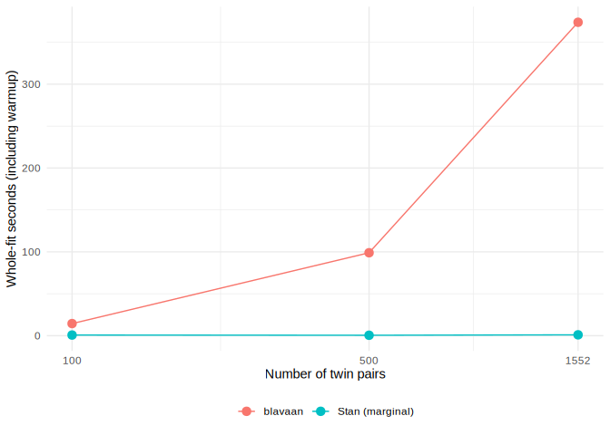
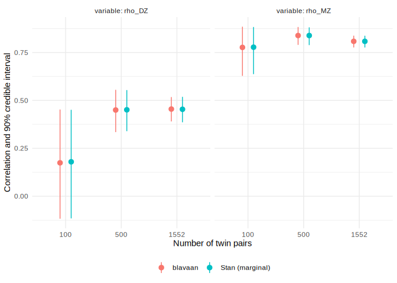

# Stan (Marginal Likelihood) vs blavaan: Timing Benchmark


## Overview

This illustration compares marginal likelihood estimation in Stan with
data augmentation in *blavaan*, with **one run per method at each sample
size**. Both fit unrestricted MZ and DZ correlations, with liability
means fixed to zero, variances fixed to one, and thresholds shared
between twins and groups. This is not the constrained simplex ACE model
used in the tutorial.

| Feature | Stan (marginal likelihood) | blavaan (data augmentation) |
|----|----|----|
| Likelihood | Multinomial on $K(K+1)/2$ reduced cell counts | Gaussian density on augmented liabilities |
| Likelihood evaluation at fixed $K$ | Fixed-size cell probability calculation | Observation-specific work grows with $N$ |
| Backend | CmdStanR / CmdStan | blavaan / rstan, precompiled model |

Both methods use independent Uniform$(-1,1)$ correlation priors (LKJ(1)
for blavaan’s bivariate correlation matrices). The matched threshold
prior is $u_1,u_2\overset{\mathrm{iid}}\sim N(0,1.5^2)$, with
$\tau_1=u_1$ and $\tau_2=\tau_1+\exp(u_2)$: the normal prior applies to
the first threshold and the log spacing, rather than independently to
the ordered thresholds. Blavaan uses finite outer endpoints $\pm30$,
whereas Stan uses infinite endpoints.

Each fit uses three parallel chains, 500 warmup and 1,000 post-warmup
iterations per chain, seed 42, `adapt_delta = 0.95`, and
`max_treedepth = 12`. These single-run timings are illustrative; total
runtime also depends on adaptation, posterior geometry, and
implementation overhead.

## Setup

Run through the project R environment (`renv` is activated by
`.Rprofile`).

``` r
library(cmdstanr)
```

    This is cmdstanr version 0.9.0

    - CmdStanR documentation and vignettes: mc-stan.org/cmdstanr

    - CmdStan path: /home/marklai/.cmdstan/cmdstan-2.40.0

    - CmdStan version: 2.40.0

``` r
library(blavaan)
```

    Loading required package: Rcpp

    This is blavaan 0.6-1

    On multicore systems, we suggest use of future::plan("multicore") or
      future::plan("multisession") for faster post-MCMC computations.

``` r
library(posterior)
```

    This is posterior version 1.7.0

    Attaching package: 'posterior'

    The following objects are masked from 'package:stats':

        mad, sd, var

    The following objects are masked from 'package:base':

        %in%, match

``` r
library(here)
```

    here() starts at /home/marklai/Research/supp-in-articles/bayes-ace-ordinal-supp

``` r
library(dplyr)
```

    Attaching package: 'dplyr'

    The following objects are masked from 'package:stats':

        filter, lag

    The following objects are masked from 'package:base':

        intersect, setdiff, setequal, union

``` r
library(tidyr)
library(ggplot2)
options(mc.cores = 3)
future::plan(future::sequential)
```

``` r
ace_cmp <- cmdstan_model(here("stan", "ace_ordinal_symmetry_for_compare.stan"))
```

## Data and Model

The BMI category frequencies from Jöreskog (2021) contain 794 MZ and 758
DZ twin pairs. The fixed-seed subsampling sequence is the same as in the
original notebook.

``` r
make_group <- function(counts, group) {
    data.frame(
        zygosity = group,
        twin1 = ordered(rep(rep(1:3, 3), counts), levels = 1:3),
        twin2 = ordered(rep(rep(1:3, each = 3), counts), levels = 1:3)
    )
}
dat_full <- rbind(
    make_group(c(325, 60, 7, 78, 150, 40, 8, 38, 88), "MZ"),
    make_group(c(202, 97, 19, 96, 112, 64, 46, 56, 66), "DZ")
)
set.seed(1234)
dat_100 <- dat_full[sample.int(nrow(dat_full), 100), ]
dat_500 <- dat_full[sample.int(nrow(dat_full), 500), ]
datasets <- list(`100` = dat_100, `500` = dat_500, full = dat_full)

data.frame(
    N = vapply(datasets, nrow, integer(1)),
    MZ = vapply(datasets, function(x) sum(x$zygosity == "MZ"), integer(1)),
    DZ = vapply(datasets, function(x) sum(x$zygosity == "DZ"), integer(1))
) |>
    knitr::kable(caption = "Twin-pair counts in each benchmark data set")
```

|      |    N |  MZ |  DZ |
|:-----|-----:|----:|----:|
| 100  |  100 |  55 |  45 |
| 500  |  500 | 262 | 238 |
| full | 1552 | 794 | 758 |

Twin-pair counts in each benchmark data set

``` r
ace_blavaan_mod <- "
    twin1 ~~ twin2
    twin1 ~~ 1*twin1
    twin2 ~~ 1*twin2
    twin1 ~ 0*1
    twin2 ~ 0*1
    twin1 | th1*t1 + th2*t2
    twin2 | th1*t1 + th2*t2
"
```

## Fitting and Saving Results

Both timers start before method-specific input preparation and stop when
the fitting call returns. They include initialization, warmup, sampling,
and internal package post-processing. Compilation, explicit draw
extraction, summaries, and cache I/O are outside the timer. The backends
perform different internal tasks, so these are practical whole-fit
costs, rather than a timing of marginalization alone.

``` r
to_ltri <- function(tab) {
    symm <- tab + t(tab) - diag(diag(tab))
    as.integer(symm[lower.tri(symm, diag = TRUE)])
}

# Common summaries of the two correlations and two actual thresholds.
summarise_fit <- function(draws, sampler, elapsed) {
    summ <- as.data.frame(summarise_draws(
        draws, mean = mean, sd = sd,
        q05 = function(x) unname(quantile(x, 0.05)),
        q95 = function(x) unname(quantile(x, 0.95)),
        rhat = posterior::rhat, ess_bulk = posterior::ess_bulk,
        ess_tail = posterior::ess_tail
    ))
    list(
        elapsed = unname(elapsed),
        summary = summ,
        diagnostics = data.frame(
            rhat_max = max(summ$rhat),
            ess_bulk_min = min(summ$ess_bulk),
            ess_tail_min = min(summ$ess_tail),
            divergences = sum(sampler[, , "divergent__"]),
            treedepth_hits = sum(sampler[, , "treedepth__"] >= 12)
        )
    )
}

run_stan <- function(dat, seed = 42) {
    start <- proc.time()[[3]]
    tab_mz <- with(dat[dat$zygosity == "MZ", ], table(twin1, twin2))
    tab_dz <- with(dat[dat$zygosity == "DZ", ], table(twin1, twin2))
    fit <- ace_cmp$sample(
        data = list(k = 3L, ltri_ns1 = to_ltri(tab_mz), ltri_ns2 = to_ltri(tab_dz)),
        chains = 3, parallel_chains = 3,
        iter_warmup = 500, iter_sampling = 1000,
        seed = seed, refresh = 0, sig_figs = 18,
        adapt_delta = 0.95, max_treedepth = 12
    )
    elapsed <- proc.time()[[3]] - start
    draws <- fit$draws(c("rho1", "rho2", "thres"), format = "draws_array")
    draws <- draws[, , c("rho1", "rho2", "thres[1]", "thres[2]"), drop = FALSE]
    dimnames(draws)[[3]] <- c("rho_MZ", "rho_DZ", "tau1", "tau2")
    summarise_fit(draws, fit$sampler_diagnostics(format = "draws_array"), elapsed)
}

run_blavaan <- function(dat, seed = 42) {
    start <- proc.time()[[3]]
    fit <- bcfa(
        ace_blavaan_mod, data = dat, ordered = c("twin1", "twin2"),
        group = "zygosity", group.label = c("MZ", "DZ"), target = "stan",
        dp = dpriors(tau = "normal(0,1.5)", rho = "beta(1,1)"),
        n.chains = 3, burnin = 500, sample = 1000, seed = seed, test = "none",
        bcontrol = list(
            cores = 3, refresh = 0,
            control = list(adapt_delta = 0.95, max_treedepth = 12)
        )
    )
    elapsed <- proc.time()[[3]] - start
    # Map parameters by fitted group/threshold identifiers, not printed row positions.
    pt <- as.data.frame(fit@ParTable)
    cor_rows <- subset(pt, op == "~~" & lhs != rhs)
    cor_names <- cor_rows$pxnames[match(c("MZ", "DZ"), fit@Data@group.label[cor_rows$group])]
    tau_names <- vapply(c("t1", "t2"), function(threshold) {
        unique(pt$pxnames[pt$op == "|" & pt$rhs == threshold])
    }, character(1))
    draws <- as.array(fit@external$mcmcout)[, , c(cor_names, tau_names), drop = FALSE]
    dimnames(draws)[[3]] <- c("rho_MZ", "rho_DZ", "tau1", "tau2")
    sampler <- rstan::get_sampler_params(fit@external$mcmcout, inc_warmup = FALSE)
    sampler <- aperm(simplify2array(sampler), c(1, 3, 2))
    summarise_fit(as_draws_array(draws), sampler, elapsed)
}
```

Each method’s result is saved immediately to
`notebooks/bench_stan_blavaan_<100|500|full>_<stan|blavaan>.rds`.
Subsequent renders read these files without refitting. To rerun a fit,
delete its cache file first. These files are separate from the older
benchmark caches.

``` r
results <- list()
for (name in names(datasets)) {
    results[[name]] <- list()
    for (method in c("stan", "blavaan")) {
        cache <- here("notebooks", paste0("bench_stan_blavaan_", name, "_", method, ".rds"))
        if (file.exists(cache)) {
            result <- readRDS(cache)
        } else {
            result <- if (method == "stan") run_stan(datasets[[name]]) else run_blavaan(datasets[[name]])
            saveRDS(result, cache)
        }
        results[[name]][[method]] <- result
    }
}

# Unrounded timings for inline extraction in paper2.qmd.
timing <- tibble(
    N = vapply(datasets, nrow, integer(1)),
    stan_seconds = vapply(results, function(x) x$stan$elapsed, numeric(1)),
    blavaan_seconds = vapply(results, function(x) x$blavaan$elapsed, numeric(1))
)
saveRDS(timing, here("notebooks", "benchmark-stan-blavaan-timing.rds"))
```

## Results

### Timing

``` r
timing |>
    mutate(
        speedup = blavaan_seconds / stan_seconds,
        across(where(is.double), function(x) round(x, 2))
    ) |>
    knitr::kable(
        col.names = c("N", "Stan (s)", "blavaan (s)", "Speedup (×)"),
        caption = "Whole-fit elapsed time including warmup: one run per method and sample size"
    )
```

|    N | Stan (s) | blavaan (s) | Speedup (×) |
|-----:|---------:|------------:|------------:|
|  100 |     0.76 |       14.44 |       19.10 |
|  500 |     0.51 |       98.93 |      195.13 |
| 1552 |     1.02 |      373.89 |      368.00 |

Whole-fit elapsed time including warmup: one run per method and sample
size

``` r
timing_long <- timing |>
    pivot_longer(-N, names_to = "Method", values_to = "seconds") |>
    mutate(Method = recode(Method, stan_seconds = "Stan (marginal)", blavaan_seconds = "blavaan"))
ggplot(timing_long, aes(N, seconds, color = Method)) +
    geom_line() +
    geom_point(size = 3) +
    scale_x_log10(breaks = c(100, 500, 1552)) +
    labs(x = "Number of twin pairs", y = "Whole-fit seconds (including warmup)", color = NULL) +
    theme_minimal() +
    theme(legend.position = "bottom")
```



### Convergence and Correlation Estimates

Basic diagnostics summarize the same four structural parameters for both
methods. The correlation intervals use the 5th and 95th percentiles of
post-warmup draws (90% equal-tail credible intervals).

``` r
diagnostics <- estimates <- list()
for (name in names(results)) {
    for (method in c("stan", "blavaan")) {
        result <- results[[name]][[method]]
        label <- if (method == "stan") "Stan (marginal)" else "blavaan"
        id <- paste(name, method, sep = "_")
        diagnostics[[id]] <- mutate(result$diagnostics, N = nrow(datasets[[name]]), Method = label, .before = 1)
        estimates[[id]] <- mutate(result$summary, N = nrow(datasets[[name]]), Method = label, .before = 1)
    }
}
bind_rows(diagnostics) |>
    mutate(across(where(is.double), function(x) round(x, 3))) |>
    knitr::kable(caption = "Basic convergence diagnostics for each fit")
```

| N | Method | rhat_max | ess_bulk_min | ess_tail_min | divergences | treedepth_hits |
|---:|:---|---:|---:|---:|---:|---:|
| 100 | Stan (marginal) | 1.001 | 2502.628 | 2021.696 | 0 | 0 |
| 100 | blavaan | 1.003 | 1099.622 | 1769.393 | 0 | 0 |
| 500 | Stan (marginal) | 1.001 | 2456.631 | 2176.795 | 0 | 0 |
| 500 | blavaan | 1.002 | 1170.397 | 1683.690 | 0 | 0 |
| 1552 | Stan (marginal) | 1.006 | 2482.876 | 1622.715 | 0 | 0 |
| 1552 | blavaan | 1.003 | 1295.288 | 2080.127 | 0 | 0 |

Basic convergence diagnostics for each fit

``` r
correlations <- bind_rows(estimates) |>
    filter(variable %in% c("rho_MZ", "rho_DZ"))
correlations |>
    select(N, Method, variable, mean, sd, q05, q95) |>
    mutate(across(where(is.double), function(x) round(x, 4))) |>
    knitr::kable(caption = "Correlation posterior mean, SD, and 90% credible interval")
```

|    N | Method          | variable |   mean |     sd |     q05 |    q95 |
|-----:|:----------------|:---------|-------:|-------:|--------:|-------:|
|  100 | Stan (marginal) | rho_MZ   | 0.7782 | 0.0769 |  0.6375 | 0.8835 |
|  100 | Stan (marginal) | rho_DZ   | 0.1796 | 0.1736 | -0.1159 | 0.4512 |
|  100 | blavaan         | rho_MZ   | 0.7771 | 0.0792 |  0.6285 | 0.8852 |
|  100 | blavaan         | rho_DZ   | 0.1744 | 0.1749 | -0.1174 | 0.4526 |
|  500 | Stan (marginal) | rho_MZ   | 0.8391 | 0.0291 |  0.7891 | 0.8818 |
|  500 | Stan (marginal) | rho_DZ   | 0.4513 | 0.0652 |  0.3397 | 0.5541 |
|  500 | blavaan         | rho_MZ   | 0.8391 | 0.0283 |  0.7902 | 0.8835 |
|  500 | blavaan         | rho_DZ   | 0.4501 | 0.0674 |  0.3346 | 0.5556 |
| 1552 | Stan (marginal) | rho_MZ   | 0.8088 | 0.0189 |  0.7766 | 0.8378 |
| 1552 | Stan (marginal) | rho_DZ   | 0.4539 | 0.0404 |  0.3861 | 0.5189 |
| 1552 | blavaan         | rho_MZ   | 0.8088 | 0.0189 |  0.7768 | 0.8383 |
| 1552 | blavaan         | rho_DZ   | 0.4551 | 0.0386 |  0.3905 | 0.5178 |

Correlation posterior mean, SD, and 90% credible interval

``` r
ggplot(correlations, aes(factor(N), mean, ymin = q05, ymax = q95, color = Method)) +
    geom_pointrange(position = position_dodge(width = 0.4)) +
    facet_wrap(~variable, labeller = label_both) +
    labs(x = "Number of twin pairs", y = "Correlation and 90% credible interval", color = NULL) +
    theme_minimal() +
    theme(legend.position = "bottom")
```


