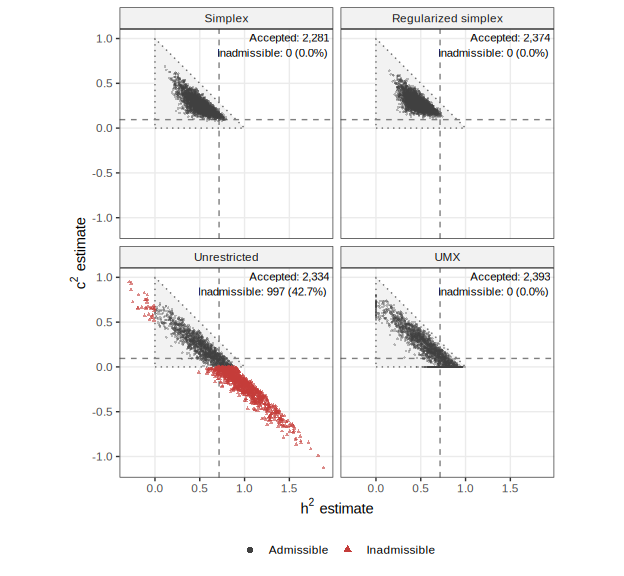
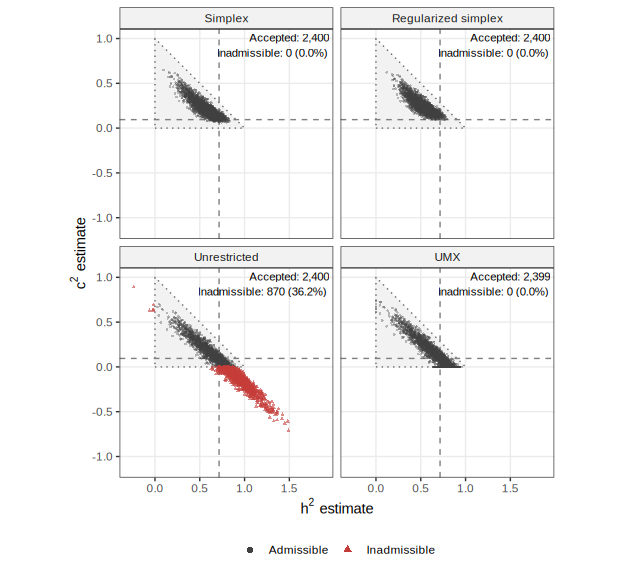
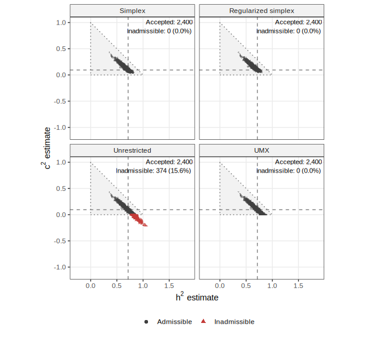

# Simulation results

This empirical-resampling evaluation uses the symmetrized Jöreskog BMI
twin tables as the data-generating distributions. It includes 50, 100,
and 500 pairs per zygosity group. The stored output,
`simulation/sim_ace_joreskog-2.rds`, reports 2,400 analyzed replications
per condition. The design is an empirical-resampling evaluation, not a
simulation from known ACE parameters: the reference values are two-step
polychoric estimates from the symmetrized tables, and the generating
distributions need not satisfy the fitted Gaussian liability model with
common thresholds.

The methods are Stan with simplex ACE proportions (`stan`), Stan with a
regularizing simplex prior (`stan_reg`), Stan with unrestricted twin
correlations (`stan_nc`), and UMX/OpenMx (`umx`). All three Stan models
use standard-normal threshold priors; their ACE/correlation priors and
parameter spaces differ. In Stan, convergence requires no divergent
transitions, $\hat R < 1.01$, and bulk effective sample size greater
than 400 for the reported ACE quantities. Stan retries with increasing
`adapt_delta` and `max_treedepth`. UMX convergence records successful
optimizer status and finite estimates; standard-error availability,
boundary estimates, and profile-interval success are distinct outcomes.
A zero variance component is an admissible boundary estimate.
Point-estimate metrics use accepted fits; interval coverage and width
use fits with available intervals. The reported interval counts make
those denominators explicit.

In the tables, **Simplex**, **Regularized simplex**, and
**Unrestricted** denote the three Stan methods above, and **UMX**
denotes UMX/OpenMx. All reported intervals have nominal 90% coverage.
Stan point estimates are posterior means.

## Results overview

Convergence was high across the evaluated conditions, ranging from 95.0%
to 100.0%
(<a href="#tbl-sim-diagnostics" class="quarto-xref">Table 1</a>). Both
simplex Stan methods and UMX produced admissible estimates in all
accepted fits. The unrestricted-correlation model produced admissible
posterior-mean estimates in 57.3%, 63.7%, and 84.4% of accepted fits at
50, 100, 500 pairs per group, respectively. UMX estimates remained
admissible when a variance component reached zero: the c² boundary
occurred in 37.8%, 32.7%, and 14.6% of accepted UMX fits. These boundary
estimates should be distinguished from optimizer failure and
inadmissibility.

UMX standard errors for both components were available in at least 99.8%
of attempts, but successful profile-interval computation was much less
frequent
(<a href="#tbl-sim-umx-diagnostics" class="quarto-xref">Table 2</a>).
Both component intervals succeeded in 0.6%, 6.8%, and 26.5% of attempts
as sample size increased. At 50 pairs per group, h² and c² profile
intervals were available in 83 and 32 of the 2,400 attempts,
respectively. Consequently, UMX coverage and mean-width results describe
the subset with successful interval computation, rather than all
accepted fits.

The estimation results illustrate tradeoffs between bias, variability,
and admissibility
(<a href="#tbl-h2-sim" class="quarto-xref">Table 3</a>;
<a href="#tbl-c2-sim" class="quarto-xref">Table 4</a>). At 50 pairs per
group, the unrestricted model had smaller absolute biases for both
components than the simplex methods, but larger RMSEs and frequent
inadmissible estimates. The regularized simplex method had more negative
h² bias and greater h² RMSE than the basic simplex method across the
evaluated sample sizes; its h² interval coverage was also lower. Bias
magnitudes and RMSEs generally decreased with sample size. These
findings characterize this empirical-resampling evaluation: the
reference components are descriptive targets, and the results do not
establish a general ranking under a correctly specified ACE model.

Table 1: Convergence, admissibility, and median analysis time. Each
method has 2,400 attempted replications per condition. Convergence uses
all attempts; admissibility uses accepted fits.

<table class="cell" style="width:97%;">
<colgroup>
<col style="width: 24%" />
<col style="width: 12%" />
<col style="width: 20%" />
<col style="width: 19%" />
<col style="width: 20%" />
</colgroup>
<thead>
<tr>
<th>Method</th>
<th>Accepted</th>
<th>Convergence (%)</th>
<th>Admissible (%)</th>
<th>Median time (s)</th>
</tr>
</thead>
<tbody>
<tr>
<td colspan="5">50 pairs/group</td>
</tr>
<tr>
<td>Simplex</td>
<td>2281</td>
<td>95.0</td>
<td>100.0</td>
<td>1.69</td>
</tr>
<tr>
<td>Regularized simplex</td>
<td>2374</td>
<td>98.9</td>
<td>100.0</td>
<td>1.59</td>
</tr>
<tr>
<td>Unrestricted</td>
<td>2334</td>
<td>97.2</td>
<td>57.3</td>
<td>1.36</td>
</tr>
<tr>
<td>UMX</td>
<td>2393</td>
<td>99.7</td>
<td>100.0</td>
<td>0.63</td>
</tr>
<tr>
<td colspan="5">100 pairs/group</td>
</tr>
<tr>
<td>Simplex</td>
<td>2400</td>
<td>100.0</td>
<td>100.0</td>
<td>1.76</td>
</tr>
<tr>
<td>Regularized simplex</td>
<td>2400</td>
<td>100.0</td>
<td>100.0</td>
<td>1.70</td>
</tr>
<tr>
<td>Unrestricted</td>
<td>2400</td>
<td>100.0</td>
<td>63.7</td>
<td>1.41</td>
</tr>
<tr>
<td>UMX</td>
<td>2399</td>
<td>100.0</td>
<td>100.0</td>
<td>0.79</td>
</tr>
<tr>
<td colspan="5">500 pairs/group</td>
</tr>
<tr>
<td>Simplex</td>
<td>2400</td>
<td>100.0</td>
<td>100.0</td>
<td>1.89</td>
</tr>
<tr>
<td>Regularized simplex</td>
<td>2400</td>
<td>100.0</td>
<td>100.0</td>
<td>1.74</td>
</tr>
<tr>
<td>Unrestricted</td>
<td>2400</td>
<td>100.0</td>
<td>84.4</td>
<td>1.37</td>
</tr>
<tr>
<td>UMX</td>
<td>2400</td>
<td>100.0</td>
<td>100.0</td>
<td>0.54</td>
</tr>
</tbody>
</table>

Median time is per attempted analysis, including retries and interval
computations when requested, and excludes compilation and data
generation.

Table 2: UMX boundary and interval outcomes. The c² boundary rate uses
accepted fits; SE and joint profile-CI success rates use all 2,400
attempts per condition.

| Pairs/group | c² boundary (%) | SE success (%) | Both profile CIs succeed (%) |
|-------------|-----------------|----------------|------------------------------|
| 50          | 37.8            | 99.8           | 0.6                          |
| 100         | 32.7            | 100.0          | 6.8                          |
| 500         | 14.6            | 100.0          | 26.5                         |

UMX SE success requires standard errors for both components, and joint
profile-CI success requires both component profile intervals to succeed.
The component-specific interval counts are shown in
<a href="#tbl-h2-sim" class="quarto-xref">Table 3</a> and
<a href="#tbl-c2-sim" class="quarto-xref">Table 4</a>. Bias and RMSE use
accepted fits, including inadmissible estimates from the unrestricted
model. Coverage and mean interval width are conditional on successful
interval computation, so UMX coverage should be interpreted alongside
its interval counts. Each CI count is out of 2,400 attempted
replications.

Table 3: Estimation performance for h². Coverage and mean width use
available 90% equal-tailed posterior intervals (Stan) or
profile-likelihood intervals (UMX). CI count is the number of available
intervals out of 2,400 attempts.

<table class="cell" style="width:95%;">
<colgroup>
<col style="width: 25%" />
<col style="width: 10%" />
<col style="width: 9%" />
<col style="width: 18%" />
<col style="width: 17%" />
<col style="width: 12%" />
</colgroup>
<thead>
<tr>
<th>Method</th>
<th>Bias</th>
<th>RMSE</th>
<th>Mean CI width</th>
<th>Coverage (%)</th>
<th>CI count</th>
</tr>
</thead>
<tbody>
<tr>
<td colspan="6">50 pairs/group</td>
</tr>
<tr>
<td>Simplex</td>
<td>-0.223</td>
<td>0.253</td>
<td>0.601</td>
<td>78.1</td>
<td>2281</td>
</tr>
<tr>
<td>Regularized simplex</td>
<td>-0.259</td>
<td>0.279</td>
<td>0.555</td>
<td>57.1</td>
<td>2374</td>
</tr>
<tr>
<td>Unrestricted</td>
<td>-0.014</td>
<td>0.322</td>
<td>1.104</td>
<td>90.5</td>
<td>2334</td>
</tr>
<tr>
<td>UMX</td>
<td>-0.083</td>
<td>0.238</td>
<td>0.754</td>
<td>97.6</td>
<td>83</td>
</tr>
<tr>
<td colspan="6">100 pairs/group</td>
</tr>
<tr>
<td>Simplex</td>
<td>-0.153</td>
<td>0.194</td>
<td>0.488</td>
<td>83.9</td>
<td>2400</td>
</tr>
<tr>
<td>Regularized simplex</td>
<td>-0.193</td>
<td>0.221</td>
<td>0.470</td>
<td>68.0</td>
<td>2400</td>
</tr>
<tr>
<td>Unrestricted</td>
<td>-0.004</td>
<td>0.236</td>
<td>0.768</td>
<td>89.4</td>
<td>2400</td>
</tr>
<tr>
<td>UMX</td>
<td>-0.052</td>
<td>0.182</td>
<td>0.637</td>
<td>86.5</td>
<td>342</td>
</tr>
<tr>
<td colspan="6">500 pairs/group</td>
</tr>
<tr>
<td>Simplex</td>
<td>-0.047</td>
<td>0.084</td>
<td>0.260</td>
<td>92.4</td>
<td>2400</td>
</tr>
<tr>
<td>Regularized simplex</td>
<td>-0.070</td>
<td>0.097</td>
<td>0.257</td>
<td>86.8</td>
<td>2400</td>
</tr>
<tr>
<td>Unrestricted</td>
<td>-0.006</td>
<td>0.103</td>
<td>0.339</td>
<td>90.0</td>
<td>2400</td>
</tr>
<tr>
<td>UMX</td>
<td>-0.014</td>
<td>0.092</td>
<td>0.302</td>
<td>88.8</td>
<td>1388</td>
</tr>
</tbody>
</table>

Table 4: Estimation performance for c². Coverage and mean width use
available 90% equal-tailed posterior intervals (Stan) or
profile-likelihood intervals (UMX). CI count is the number of available
intervals out of 2,400 attempts.

<table class="cell" style="width:95%;">
<colgroup>
<col style="width: 25%" />
<col style="width: 10%" />
<col style="width: 9%" />
<col style="width: 18%" />
<col style="width: 17%" />
<col style="width: 12%" />
</colgroup>
<thead>
<tr>
<th>Method</th>
<th>Bias</th>
<th>RMSE</th>
<th>Mean CI width</th>
<th>Coverage (%)</th>
<th>CI count</th>
</tr>
</thead>
<tbody>
<tr>
<td colspan="6">50 pairs/group</td>
</tr>
<tr>
<td>Simplex</td>
<td>0.172</td>
<td>0.198</td>
<td>0.499</td>
<td>92.1</td>
<td>2281</td>
</tr>
<tr>
<td>Regularized simplex</td>
<td>0.193</td>
<td>0.211</td>
<td>0.465</td>
<td>81.0</td>
<td>2374</td>
</tr>
<tr>
<td>Unrestricted</td>
<td>-0.043</td>
<td>0.292</td>
<td>0.982</td>
<td>90.7</td>
<td>2334</td>
</tr>
<tr>
<td>UMX</td>
<td>0.075</td>
<td>0.208</td>
<td>0.705</td>
<td>78.1</td>
<td>32</td>
</tr>
<tr>
<td colspan="6">100 pairs/group</td>
</tr>
<tr>
<td>Simplex</td>
<td>0.127</td>
<td>0.160</td>
<td>0.414</td>
<td>91.4</td>
<td>2400</td>
</tr>
<tr>
<td>Regularized simplex</td>
<td>0.155</td>
<td>0.177</td>
<td>0.400</td>
<td>82.5</td>
<td>2400</td>
</tr>
<tr>
<td>Unrestricted</td>
<td>-0.022</td>
<td>0.215</td>
<td>0.698</td>
<td>89.9</td>
<td>2400</td>
</tr>
<tr>
<td>UMX</td>
<td>0.048</td>
<td>0.162</td>
<td>0.565</td>
<td>49.3</td>
<td>221</td>
</tr>
<tr>
<td colspan="6">500 pairs/group</td>
</tr>
<tr>
<td>Simplex</td>
<td>0.042</td>
<td>0.073</td>
<td>0.234</td>
<td>94.2</td>
<td>2400</td>
</tr>
<tr>
<td>Regularized simplex</td>
<td>0.062</td>
<td>0.084</td>
<td>0.231</td>
<td>88.8</td>
<td>2400</td>
</tr>
<tr>
<td>Unrestricted</td>
<td>0.001</td>
<td>0.094</td>
<td>0.314</td>
<td>90.9</td>
<td>2400</td>
</tr>
<tr>
<td>UMX</td>
<td>0.014</td>
<td>0.083</td>
<td>0.285</td>
<td>68.1</td>
<td>636</td>
</tr>
</tbody>
</table>

## Joint estimates and admissibility

<a href="#fig-sim-admissibility-50" class="quarto-xref">Figure 1</a>,
<a href="#fig-sim-admissibility-100" class="quarto-xref">Figure 2</a>,
and
<a href="#fig-sim-admissibility-500" class="quarto-xref">Figure 3</a>
show the joint distributions of the component estimates among accepted
fits. The axes are shared across methods and sample sizes and include
all plotted estimates. The shaded triangle marks the admissible region:
$h^2 \geq 0$, $c^2 \geq 0$, and $h^2 + c^2 \leq 1$. Dashed lines mark
the empirical-reference values, rather than known generating ACE
parameters. UMX zero-boundary estimates are admissible; red triangles
identify inadmissible estimates from the unrestricted-correlation model.

Figure 1: Joint h² and c² estimates with 50 pairs per zygosity group,
among accepted fits. Stan estimates are posterior means; UMX estimates
are standardized variance proportions. The dotted triangle bounds the
admissible region, red triangles mark inadmissible estimates, and dashed
lines mark the empirical-reference values. Percentages in each panel use
accepted fits.

Figure 2: Joint h² and c² estimates with 100 pairs per zygosity group,
among accepted fits. Point summaries, boundaries, reference lines, and
percentage denominators are as in
<a href="#fig-sim-admissibility-50" class="quarto-xref">Figure 1</a>.

Figure 3: Joint h² and c² estimates with 500 pairs per zygosity group,
among accepted fits. Point summaries, boundaries, reference lines, and
percentage denominators are as in
<a href="#fig-sim-admissibility-50" class="quarto-xref">Figure 1</a>.

