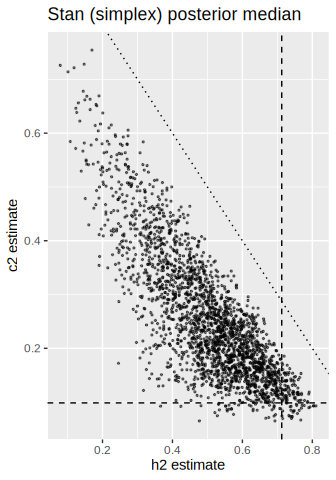
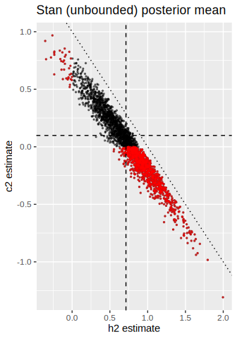
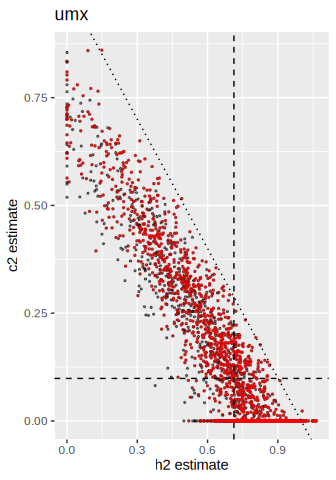

# Simulation results

The simulation is based on the ACE model with the same parameters as in
the Jöreskog example, but with smaller sample sizes (50 and 100 pairs),
and with 2,500 replications. The results are stored in
`simulation/sim_ace_joreskog-1.rds`, and the code to run the simulation
is in `simulation/sim_ace_joreskog.R`. The methods compared are:

- Stan with simplex parameterization (`stan`)
- Stan with unbounded parameterization (`stan_nc`)
- umx with default settings (`umx`)

For Stan, convergence was achieved if there were no divergent
transitions, the $\hat R$ values were less than 1.01, and the effective
sample size was greater than 400. When divergent transitions were
present, we reran the Stan NUTS sampler up to three times by increasing
the `adapt_delta` parameter from 0.8 (default) to 0.90, 0.95, and 0.99,
and the corresponding `max_treedepth` from 10 (default) to 12 and 15.
For umx, convergence was considered achieved if the optimization
algorithm converged and the Hessian matrix was positive definite, so
that both point and standard errors could be computed. For all methods,
we considered estimates to be admissible if (in the case of Stan, the
posterior means of) both $h^2$ and $c^2$ were between 0 and 1, and their
sum was less than or equal to 1.

Table 1: Convergence and admissibility rates

<table class="cell" style="width:95%;">
<colgroup>
<col style="width: 16%" />
<col style="width: 15%" />
<col style="width: 17%" />
<col style="width: 6%" />
<col style="width: 15%" />
<col style="width: 17%" />
<col style="width: 6%" />
</colgroup>
<thead>
<tr>
<th></th>
<th colspan="3">n = 50</th>
<th colspan="3">n = 100</th>
</tr>
<tr>
<th>metric</th>
<th>Stan (simplex)</th>
<th>Stan (unbounded)</th>
<th>umx</th>
<th>Stan (simplex)</th>
<th>Stan (unbounded)</th>
<th>umx</th>
</tr>
</thead>
<tbody>
<tr>
<td>converge_rate</td>
<td>95.2</td>
<td>97.5</td>
<td>100</td>
<td>100</td>
<td>100</td>
<td>99.9</td>
</tr>
<tr>
<td>admissible_rate</td>
<td>100</td>
<td>57.2</td>
<td>27.3</td>
<td>100</td>
<td>65</td>
<td>36.2</td>
</tr>
</tbody>
</table>

Table 2: Bias, RMSE, CI width, and CI coverage for $h^2$

<table class="cell" style="width:96%;">
<colgroup>
<col style="width: 16%" />
<col style="width: 12%" />
<col style="width: 14%" />
<col style="width: 12%" />
<col style="width: 12%" />
<col style="width: 14%" />
<col style="width: 12%" />
</colgroup>
<thead>
<tr>
<th></th>
<th colspan="3">n = 50</th>
<th colspan="3">n = 100</th>
</tr>
<tr>
<th>metric</th>
<th>Stan (simplex)</th>
<th>Stan (unbounded)</th>
<th>umx</th>
<th>Stan (simplex)</th>
<th>Stan (unbounded)</th>
<th>umx</th>
</tr>
</thead>
<tbody>
<tr>
<td colspan="7">Bias</td>
</tr>
<tr>
<td>post mean</td>
<td>-0.22</td>
<td>-0.01</td>
<td>-0.07</td>
<td>-0.15</td>
<td>-0.01</td>
<td>-0.04</td>
</tr>
<tr>
<td>post median</td>
<td>-0.21</td>
<td>-0.02</td>
<td>
</td>
<td>-0.14</td>
<td>-0.01</td>
<td>
</td>
</tr>
<tr>
<td>post mode</td>
<td>-0.18</td>
<td>-0.04</td>
<td>
</td>
<td>-0.11</td>
<td>-0.02</td>
<td>
</td>
</tr>
<tr>
<td colspan="7">CI Width</td>
</tr>
<tr>
<td>Equal-tailed/Wald</td>
<td>0.60</td>
<td>1.10</td>
<td>0.93</td>
<td>0.49</td>
<td>0.77</td>
<td>0.71</td>
</tr>
<tr>
<td>HDI/Profile</td>
<td>0.58</td>
<td>1.10</td>
<td>inadmissible</td>
<td>0.47</td>
<td>0.77</td>
<td>inadmissible</td>
</tr>
<tr>
<td colspan="7">CI Coverage (%)</td>
</tr>
<tr>
<td>Equal-tailed/Wald</td>
<td>79.3</td>
<td>91.4</td>
<td>92.8</td>
<td>85.4</td>
<td>90.3</td>
<td>94.4</td>
</tr>
<tr>
<td>HDI/Profile</td>
<td>76.2</td>
<td>90.8</td>
<td>inadmissible</td>
<td>88.0</td>
<td>90.1</td>
<td>inadmissible</td>
</tr>
<tr>
<td colspan="7">RMSE</td>
</tr>
<tr>
<td>post mean</td>
<td>0.25</td>
<td>0.32</td>
<td>0.24</td>
<td>0.19</td>
<td>0.23</td>
<td>0.19</td>
</tr>
<tr>
<td>post median</td>
<td>0.25</td>
<td>0.32</td>
<td>
</td>
<td>0.19</td>
<td>0.23</td>
<td>
</td>
</tr>
<tr>
<td>post mode</td>
<td>0.26</td>
<td>0.32</td>
<td>
</td>
<td>0.18</td>
<td>0.23</td>
<td>
</td>
</tr>
</tbody>
</table>

Table 3: Bias, RMSE, CI width, and CI coverage for $c^2$

<table class="cell" style="width:96%;">
<colgroup>
<col style="width: 16%" />
<col style="width: 12%" />
<col style="width: 14%" />
<col style="width: 12%" />
<col style="width: 12%" />
<col style="width: 14%" />
<col style="width: 12%" />
</colgroup>
<thead>
<tr>
<th></th>
<th colspan="3">n = 50</th>
<th colspan="3">n = 100</th>
</tr>
<tr>
<th>metric</th>
<th>Stan (simplex)</th>
<th>Stan (unbounded)</th>
<th>umx</th>
<th>Stan (simplex)</th>
<th>Stan (unbounded)</th>
<th>umx</th>
</tr>
</thead>
<tbody>
<tr>
<td colspan="7">Bias</td>
</tr>
<tr>
<td>post mean</td>
<td>0.17</td>
<td>-0.04</td>
<td>0.07</td>
<td>0.12</td>
<td>-0.02</td>
<td>0.05</td>
</tr>
<tr>
<td>post median</td>
<td>0.16</td>
<td>-0.03</td>
<td>
</td>
<td>0.11</td>
<td>-0.01</td>
<td>
</td>
</tr>
<tr>
<td>post mode</td>
<td>0.10</td>
<td>0.01</td>
<td>
</td>
<td>0.06</td>
<td>0.01</td>
<td>
</td>
</tr>
<tr>
<td colspan="7">CI Width</td>
</tr>
<tr>
<td>Equal-tailed/Wald</td>
<td>0.50</td>
<td>0.98</td>
<td>0.60</td>
<td>0.42</td>
<td>0.70</td>
<td>0.48</td>
</tr>
<tr>
<td>HDI/Profile</td>
<td>0.46</td>
<td>0.97</td>
<td>inadmissible</td>
<td>0.39</td>
<td>0.69</td>
<td>inadmissible</td>
</tr>
<tr>
<td colspan="7">CI Coverage (%)</td>
</tr>
<tr>
<td>Equal-tailed/Wald</td>
<td>91.8</td>
<td>90.8</td>
<td>56.1</td>
<td>92.2</td>
<td>90.8</td>
<td>63.8</td>
</tr>
<tr>
<td>HDI/Profile</td>
<td>89.3</td>
<td>89.7</td>
<td>inadmissible</td>
<td>90.6</td>
<td>90.0</td>
<td>inadmissible</td>
</tr>
<tr>
<td colspan="7">RMSE</td>
</tr>
<tr>
<td>post mean</td>
<td>0.20</td>
<td>0.29</td>
<td>0.21</td>
<td>0.15</td>
<td>0.21</td>
<td>0.16</td>
</tr>
<tr>
<td>post median</td>
<td>0.20</td>
<td>0.30</td>
<td>
</td>
<td>0.15</td>
<td>0.21</td>
<td>
</td>
</tr>
<tr>
<td>post mode</td>
<td>0.21</td>
<td>0.30</td>
<td>
</td>
<td>0.16</td>
<td>0.21</td>
<td>
</td>
</tr>
</tbody>
</table>

(a) Stan (simplex) posterior median

(b) Stan (unbounded) posterior mean

(c) umx

Figure 1: Estimates of $h^2$ and $c^2$. The dashed lines indicate the
true values, and the dotted line indicates the boundary where
$h^2 + c^2 = 1$. The red points indicate estimates from replications
where the Stan (unbounded) or umx estimates were inadmissible.

